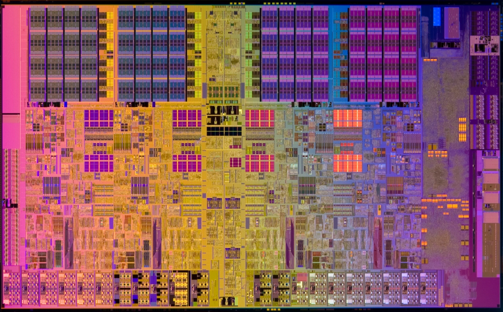
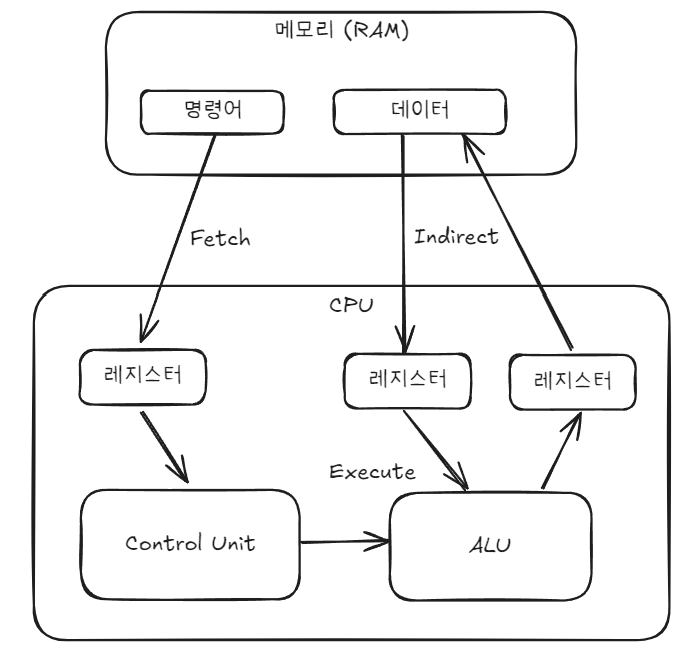
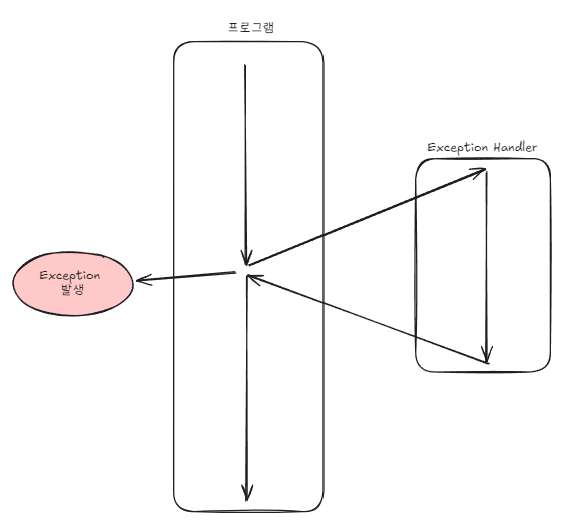

### CPU의 구조
- 크게 3가지 요소로 구성됨
    - 산술논리연산장치 (ALU, Arithmetic Logic Unit)
        - 주소 및 데이터 연산을 하는 장치
    - 제어 장치 (CU, Control Unit)
        - 명령어를 해석하고 ALU 또는 외부 장치에 제어신호를 보내 제어하는 장치
    - 레지스터 (Register)
        - 명령어, 주소, 데이터 등이 저장되는 작은 메모리

### CPU 동작
- CPU가 명령어를 수행하는 과정
    - 인출 (Fetch)로 실행할 명령어를 가져와서 CU에서 명령어를 해석하고 실행(Execute)을 함
    - 메모리에서 데이터를 주고 받아야 할 경우 간접(Indirect) 사이클로 복사 작업을 수행
    - 

### 인터럽트(Interrupt)가 발생하는 경우
- 인터럽트란?
    - 명령어 처리 중 특수한 신호로 다른 작업 처리를 요청하는 것
- 인터럽트 처리 방법
    - 인터럽트보다 현재 작업의 우선순위가 높을 경우
        - 현재 작업을 끝낸 다음 처리
    - 인터럽트의 우선순위가 더 높은 경우
        - 현재 작업중인 내용(레지스터의 내용들)을 메모리로 복사한 다음 인터럽트를 처리
            - 인터럽트 핸들러(Interrupt handler)라는 인터럽트 처리 방법을 담은 프로그램을 통해서 처리
        - 인터럽트 처리가 완료되면 메모리에서 인터럽트 처리 직전에 작업하던 내용을 복구한 다음 실행함
    - 
- 인터럽트의 종류
    - 동기 인터럽트 (예외, Exception 이라고도 함)
        - CPU 내부적으로 명령어 실행중 발생
        - 폴트 (fault)
            - 우선적으로 처리해야할 작업이 발생한 경우
                - ex) 계산 중 메모리에서 데이터를 불러와야 하는 경우
        - 트랩 (trap)
            - 잘못된 명령이 수행되어 중단하고 다음 명령부터 실행하는 경우
                - ex) Divide by 0 같은 경우 
            - 운영체제의 System Call이 trap을 활용함
        - 중단 (abort)
            - 처리가 불가능한 경우 프로세스를 중단하는 인터럽트
                - ex) fault가 발생해서 데이터를 불러오는데 데이터가 존재하지 않는 상황 
    - 비동기 예외 (하드웨어 인터럽트)
        - 외부 장치에 의해서 발생
            - 장치별로 인터럽트 핸들러가 존재
            - 인터럽트 목록에 인터럽트 벡터로 등록
                - 인터럽트가 발생하면 인터럽트 벡터를 통해 인터럽트 핸들러를 실행하여 처리