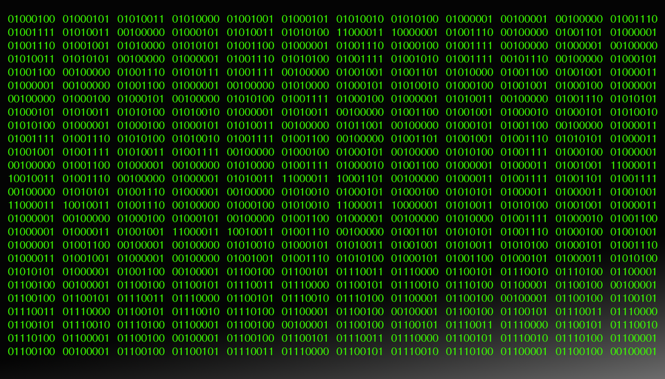

### 컴퓨터가 다루는 정보
- 컴퓨터가 다루는 정보는 크게 두가지가 있음
    - 컴퓨터가 어떤 작업을 수행할 지 알려주는 "명령어"
    - 컴퓨터가 처리하는 연산의 대상이 되는 "데이터"

### 컴퓨터가 정보를 표현하는 방법
- 현대의 컴퓨터는 on/off 를 의미하는 1/0 신호를 이용해서 모든 정보를 나타낸다
    - 1, 0 두개의 숫자로만 나타내기 때문에 binary 정보라고 한다
    - 각 숫자를 bit라고 하며 8개의 비트가 모이면 byte라고 한다
    - CPU가 한번에 처리할 수 있는 크기를 word라고 부른다
        - 예를 들어 32bit CPU의 1word = 32bit = 4byte 이다
- 모든 정보를 bit를 통해 나타내면 명령어와 데이터를 어떻게 구분할까
    - CPU 자체는 명령어와 데이터를 구분하지 못함
        - 명령으로 해석 가능한 입력과 해석 불가능한 입력만 있을뿐
    - 프로그램내에서 명령어와 데이터를 저장하는 메모리 영역을 다르게 해서 구분한다

### 명령어는 어떻게 생겼는가
- 명령어는 연산 종류를 나타내는 연산코드와 연산될 데이터를 나타내는 오퍼랜드로 구성됨
    - 연산 코드 종류
        - 데이터 전송
        - 산술/논리 연산
        - 제어 흐름 변경
        - 입출력 제어
    - 오퍼랜드 형태
        - 오퍼랜드에는 연산에 필요한 데이터나 연산할 데이터를 저장한 메모리 주소를 담고 있음
            - 명령어의 길이는 제한적이기 때문에 데이터가 큰 경우 메모리 주소로 간접적으로 나타냄
            - 오퍼랜드의 개수에 따라 0-주소, 1-주소, 2-주소, 3-주소 명령어 라고 부른다
    - 주소 지정 방식
        - 실제 연산할 데이터가 저장된 주소를 유효주소라고 하는데 유효주소를 명령어에 나타내는 방식을 주소 지정 방식이라고 한다
            - 즉시 주소 지정
                - 명령어에 연산할 데이터를 담음
            - 직접 주소 지정
                - 명령어에 데이터가 담긴 메모리의 주소를 담음
            - 간접 주소 지정
                - 명령어에 유효주소를 가리키는 정보가 있는 메모리 주소를 담음
### 이미지, 음악, 글자 같은 수많은 데이터들은 어떻게 표현되는가
- 컴퓨터는 word단위로 처리하는데 큰 파일은 어떻게 처리되서 보여지는가