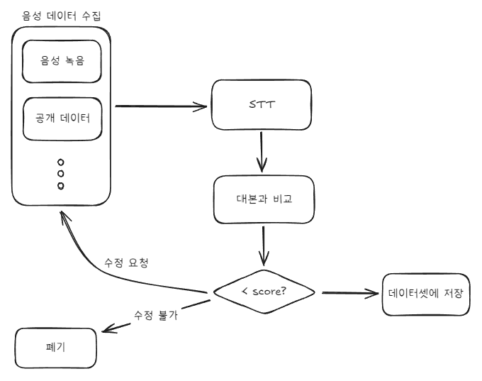
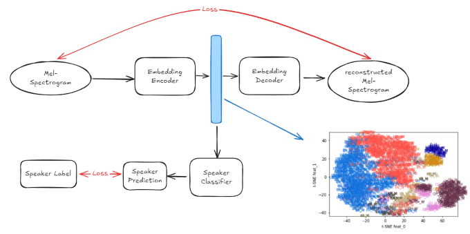
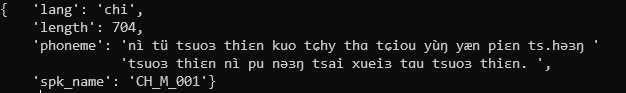
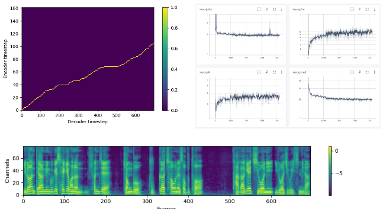

### 기간
- 회사 프로젝트
- 2021.01 ~ 2021.10 (10 개월)

### 목표
 - Virtual Human 서비스에 적용 할 다국어, 다화자 음성 생성 모델 개발 
    - 다양한 Virtual Human 캐릭터에 대응도록 다양한 목소리 생성 지원 
    - 다국어 콘텐츠를 위한 하나의 목소리로 여러 언어 발화 지원 
    - 빠른 생성 속도 (RTF < 0.5)

### 성과
- 기존 대비 추론 자원 소모 1/8로 감소
- 200개의 목소리로 4개 언어 발화가 가능해짐
- 발음 정확도가 95% => 98%로 향상됨
- 서비스 및 바우처 사업에 적용되어 회사 매출에 기여

### 과정

#### 데이터 수집 및 가공
 - 좋은 품질의 데이터를 수집하기 위해 여러 단계의 검수 과정을 진행 
    - 직접 녹음 및 공개된 데이터 등을 수집하는 작업을 진행함 
    - STT를 이용해 음성과 대본이 잘 align되어있는지 확인 
        - whisper, Google Cloud STT API 활용함
        - 인식된 텍스트와 대본간의 편집거리를 계산함
    - 일정 점수 이하의 음성은 사람이 직접 다시 확인함
    - 

#### Embedding 모델 훈련
- 목소리와 언어 특성 정보를 담은 embedding을 생성하는 모델을 따로 제작함
- End-to-End 학습 VS embedding을 따로 훈련 비교
    - embedding 모델을 따로 훈련하고 활용하는 쪽이 언어에 따른 목소리 일관성을 조금 더 잘 유지했음
    - 목소리의 일관성이 중요했기 때문에 embedding모델을 따로 훈련하는 방식을 채택함
    - 음성 모델이 학습해야하는 정보가 줄어서 조금 더 정확도가 높아진 것으로 추측
    - 

#### 텍스트 입력 처리 방식 구현
- 입력된 텍스트를 phoneme로 변환하는 기능을 구현
    - 연구에 따르면 phoneme을 사용하는 것이 음성 품질이 가장 좋음
        - https://arxiv.org/pdf/1907.04448v2
    - TTS 음성 생성을 위해서는 텍스트 → phoneme → Embedding 의 과정으로 입력에 필요한 embedding을 생성함
    - 각 언어별로 다른 phoneme를 사용하면 언어-목소리 간의 disentangle이 어려워짐 
        - 목소리의 종류가 부족한 언어에서는 다른 언어의 억양이 나타나거나 목소리의 특징이 유지가 안되는 현상이 나타남 
        - IPA라는 표준화된 발음 표기 방식을 적용하여 사용되는 phoneme를 통일함
        - 

####  모델 변경 작업
- 기존
    - GAN 기반 Mel-spectrogram 생성 모델 + mel-spec을 음성으로 변환하는 vocoder모델
    - 모델이 2개로 이루어져 있어 학습 절차도 복잡하고  추론시에도 복잡함
    - 다국어, 다화자 합성시 충분한 성능이 나오지 않음
- 신규
    - End-to-End 방식의 VITS 모델을 기반으로 작업
    - 다국어 음성 생성 관련 연구들의 내용을 적용하여 모델 구조를 변경함
        - 훈련 프로세스가 기존보다 단순해짐
        - 기존 모델 대비 음성 생성 품질이 향상됨

#### 모델 학습
- RTX 3090를 4개를 활용하여 학습함
    - Data parallel을 사용하여 분산 학습 수행
- 약 2M step 정도 학습을 진행
    - 음성 생성 모델은 loss가 감소하지 않더라도 훈련을 지속하면 품질이 향상되는 현상을 보임
    - 

#### 모델 평가
- 랜덤하게 샘플을 생성하여 평가 진행
    - 사람이 직접 들어보고 평가
    - STT로 transcript후 입력 문장과 비교

### 정리
- 데이터를 잘 정제하는 것이 매우 중요했음
    - 일부 음성에서 발음이 부정확한 문제가 있었는데 해당 음성의 일부 데이터가 잘못되어있었고 수정후 현상이 개선됨
- Input이 원하는 형태로 들어가는지 지속적인 확인은 필수적임
    - 테스트에서는 잘 동작했지만 배포 버전에서 동작이 이상했음
        - IPA 변환에 오픈소스를 이용했는데 운영체제 버전에 따라 사용 가능한 지원되는 버전이 달라서 변환결과가 다른 문제가 있었음
        - 배포 환경이 오래되었기 때문에 업그레이드 하는 방법으로 해결함
- 음성은 길이가 다양하기 때문에 몇가지 문제가 발생했음
    - 학습시 메모리 사용량이 계속 변함
        - 최대 길이의 음성에 맞춰 배치 크기를 결정
        - 지나치게 긴 음성은 자르거나 제외함
    - 짧은 데이터와 긴 데이터가 같은 배치에 들어가면 학습 효율이 떨어짐
        - 비슷한 길이의 음성끼리 묶어서 학습
    - 훈련 상황에 따라 다양한 기법을 유연하게 적용할 필요가 있음

