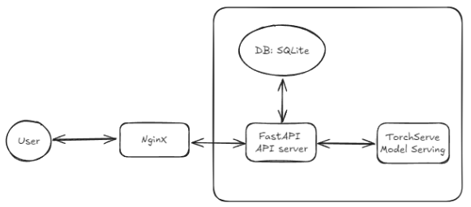
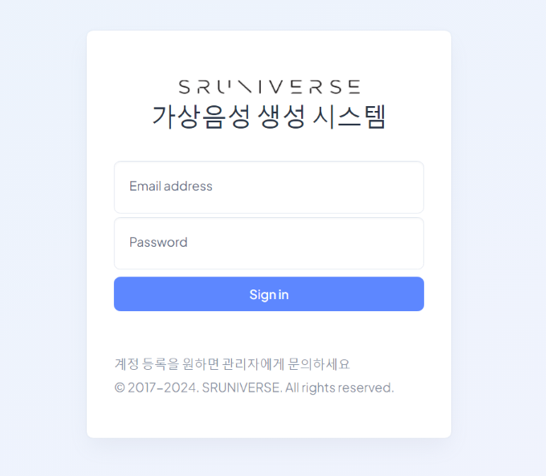
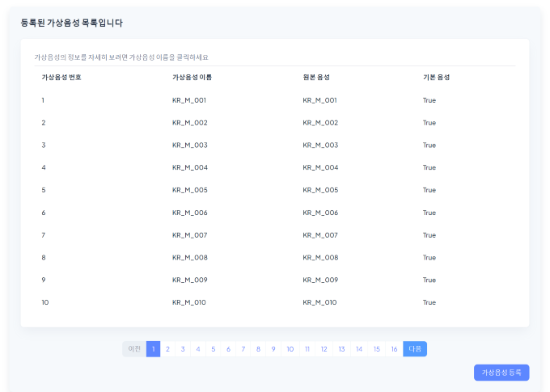
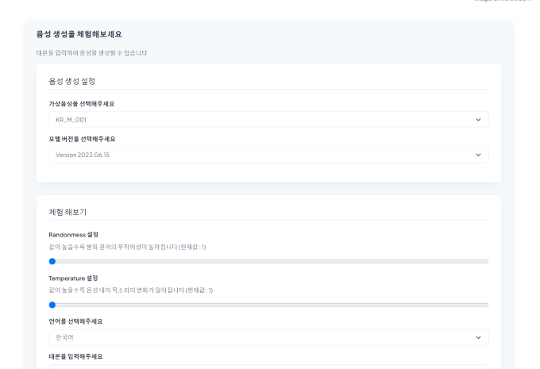
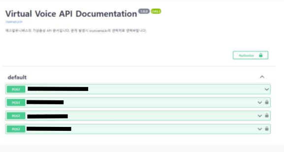

## 기간
- 회사 프로젝트
- 2021.11 ~ 2022.01 (3개월)

## 목표
- 음성 생성 API 구현 
- 허용된 사용자만 사용 하도록 인증 기능 구현
- 사용 가능한 음성 목록을 확인 및 관리 가능하도록 관리자 페이지 구현

## 성과
- 음성 생성 API 구현 및 음성 관리 도구 구현 
- Virtual Human 및 음성 서비스에서 사용
- 전반적인 MLOps 파이프라인 구축

## 과정

### 전체 구조
- 

### 모델 Serving 구현
- Torchserve를 이용해서 구현
    - Torchserve의 경우 pytorch와의 호환성과 서빙에 필요한 기능들을 다양하게 지원해서 선택함
- 모델을 torchscript를 이용해서 단일 파일로 제작
- 모델 서빙에 필요한 handler 코드를 만들고 model-archive를 생성
    - handler가 아래의 기능을 처리 할 수 있도록 구현
        - 모델이 생성 가능한 음성 정보
        - 음성 생성 요청 결과
        - 모델 상태
- 날짜를 버전으로 지정하는 방식으로 자동으로 model archive를 생성 및 배포 서버에 업로드 하는 스크립트 구현

### API 및 관리 페이지 구현
- FastAPI를 사용해서 구현함
    - FastAPI의 경우 자동으로 Swagger 문서를 생성해주는 기능이 있어 문서화 작업이 편리
- 음성을 관리하고 후처리 방식을 설정 할 수 있는 페이지 구현
    - Bootstrap5, Jinja2(python)을 이용해서 구현
    - 후처리는 librosa 라이브러리를 사용
- 로그인 및 인증은 JWT로 구현
- 사용자 정보 (사용량 추적, 로그인 정보) 관리를 위한 DB는 SQLite를 사용
    - DB에서 읽어야 할 정보가 많지 않다고 판단하여 SQLite를 선택
- 관리 페이지 UI
    -  
    -  
## 정리
- 모델을 torchscript로 만드는 과정에서 지원하지 않는 함수로 인해 script로 변환이 되지 않는 문제가 있었음
    - torchscript에서 지원하는 함수로 모델 일부를 다시 작성한 다음 모델을 훈련해서 해결함
- API를 개발하면서 JWT인증, CORS 등 웹개발 관련된 내용을 일부 경험해 볼 수 있었음
- 개발한 모델을 배포 및 API 구현을 하면서 MLOps 전체 파이프라인에 대해 경험을 쌓을 수 있었음