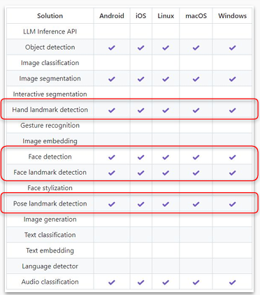
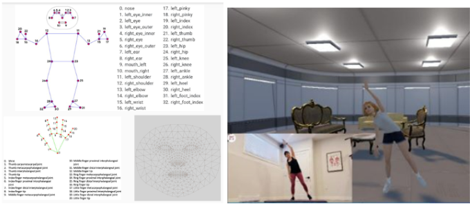

### 기간
- 회사 프로젝트
- 2023.03 ~ 2023.09 (6개월)

### 목표
- VTuber 라이브 스트리밍과 메타버스 통합 솔루션 개발 프로젝트 
    - VTuber의 동작 구현을 위한 단일 카메라 기반의 모션 캡처 기능 구현 
        - 단일 카메라로 동작 
        - 카메라에서 추정한 동작을 보정 및 연산하여 캐릭터에 움직임 반영 
        - 모션이 추정 오류에 의해 급격하게 튀지 않도록 안정화 코드 구현

### 성과
- 캐릭터가 얼굴 표정, 손동작, 몸동작을 따라 할 수 있도록 구현 및 안정화
- 유니티 동작 구조 및 유니티 개발에 대한 이해
- 유니티 패키지로 제작해서 상위 서비스에 적용

### 과정

#### 유니티와 Mediapipe 연동
- 모션 캡쳐와 관련된 AI 모델중 가볍고 성능이 좋은 mediapipe를 활용
- 오픈소스 플러그인을 이용해서 mediapipe와 unity를 연동
    - https://github.com/homuler/MediaPipeUnityPlugin
        - 
    - 최적화를 위해 불필요한 기능을 제외하고 다시 빌드해서 연동함
    - mediapipe가 지원하는 기능 중 얼굴인식, 모션캡쳐, 손인식 기능만 사용

#### 모션 연산 구현
- mediapipe에서 오는 값은 화면 프레임의 위치 x, y값과 depth에 대한 추정 z값임
- 이 값을 캐릭터의 움직임으로 바꾸기 위해 각 관절의 각도로 변환하는 계산을 구현
    - 사람의 몸에서 중심이 되는 방향은 가슴 및 배가 향하는 방향이므로 이를 기준으로 벡터 연산을 하여 각 관절의 방향을 구함
    - 

#### 모션 안정화
- mediapipe에서 출력하는 x, y는 이미지 내의 위치고 z는 모델이 추정하는 값임 
    - 작은 오차에도 각도는 크게 변할 수 있음 
    - z가 완전히 잘못된 값인 경우가 있음 
        - 갑작스럽게 큰 변화는 값을 작게하여 적용하도록 구현
        - 실제 관절이 가동 가능한 각도인지를 평가하여 변화를 적용함
- 카메라에서 벗어나거나 모션캡처에 실패한 경우
    - 기본 애니메이션 적용

#### 캐릭터 적용 및 패키징
- 캐릭터를 불러와서 자동으로 모션이 적용되도록 구현
- 메타버스에서 적용 가능하도록 unitypackage로 패키징

### 정리
-  유니티의 동작 방식을 이해하고 유니티로 소프트웨어 개발 방법을 학습
    - C# 및 코루틴 활용 
    - 애니메이션과 상태머신 사용 
    - 3D 게임 개발 관련 기본 지식 습득 
- 다른 개발 및 디자인 인원과 협업
    - 개발 일정을 조율하고 그에 맞춰 개발 작업을 수행 
    - 개발 작업물을 리뷰하고 수정 사항등을 반영하며 개발 협업 과정을 습득

