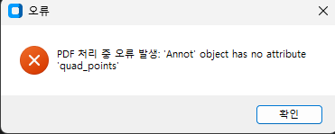
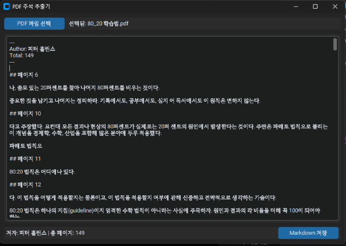
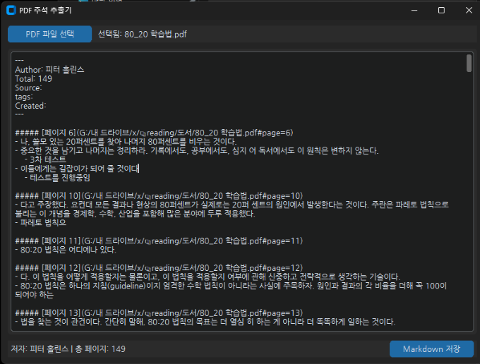

## 기간
- 개인 프로젝트
- 2025.04 ~ 2025.04


## 목표
- 개인적으로 구매한 대부분의 도서 파일을 PDF로 보관하고 PDF를 통해서 책을 읽음
    - PDF에 하이라이트를 하는데 이를 메모로 옮기는데는 시간이 많이 걸림
    - Readwise 서비스 처럼 읽은 책의 highlight를 노트로 바로 보내는 프로그램 구현
        - PDF 파일에서 하이라이트를 추출하는 프로그램 제작
        - 추출한 하이라이트를 `.md` 형식으로 저장하여 옵시디언에서 활용
        - 하이라이트가 있는 페이지를 바로 볼 수 있도록 pdf 링크를 생성


## 성과
- PDF에서 하이라이트를 추출해서 `.md`로 저장하는 프로그램 구현
- Vibe Coding을 이용해서 제작함
    - Vibe Coding으로 개발하는 방법을 습득


## 과정

### 프롬프트로 기본 코드 구현
- Gemini 2.5 Pro (experimental)에서 Canvas 기능을 이용
- 아래와 같은 프롬프트로 1차 생성
```
pdf에서 하이라이트, 밑줄, 메모등을 추출해서 gui로 보여주는 프로그램을 작성해줘. 이렇게 추출된 내용은 편집할 수 있도록 구현해줘. 파일을 선택할 수 있는 gui와 md파일로 저장하는 기능을 구현해줘. 하이라이트와 연관된 메모는 bullet list로 하이라이트 바로 아래에 표시되도록 해줘. 하이라이트와 밑줄은 적용된 텍스트가 나오게 해줘. obsidian에서 활용 가능하도록 obsidian 속성으로 저자(Author)와 총페이지수(Total)을 표시해줘.
```

### 오류 고치기
- 생성된 코드를 실행 후 PDF 추출을 시도해보니 아래의 오류가 발생함
- 
- quad_points 속성이 없는 pdf도 있어서 발생한 문제. 해당 케이스를 제외하도록 소스에 추가하면 간단하지만 이 오류 수정을 AI에 맡겨봄
```
'Annot' object has no attribute 'quad_points'라는 오류가 발생하는데 이 문제를 해결해줘
```
- 오류가 수정되어 정상적으로 추출됨을 확인
    - 
### 수정하기
- 출력되는 형식은 직접 수정하기로 결정
    - 프롬프트로 코드 수정을 요청하면 전체를 재작성하기 때문에 시간이 많이 소요됨
    - 원하는 형태로 만들때까지 여러번 반복이 필요한데 직접 수정하는 것보다 더 긴 시간이 소요될 수 있음
- 최종적으로 아래와 같이 수정
    - 폰트를 '나눔고딕'으로 변경
    - 원본 하이라이트로 바로 갈 수 있도록 PDF 링크를 추가
    - 내용을 bullet list로 표시하도록 변경
    - 하이라이트에 추가한 메모를 보이도록 수정
    - 

## 정리
- 이 프로젝트를 진행하는데 프롬프팅 30분 + 직접 수정 2시간 정도가 소요
- 큰 프로젝트에서는 사용에 많은 주의가 필요해 보임
    - 큰 프로젝트에서는 context length 제한때문에 전체 소스를 넣기 어려움
    - 코드를 다시 작성하기 때문에 다른 부분들과 연결된 코드는 문제가 생길수 있음
- 세부적인 디테일을 구현하기 위해 "프롬프트 수정 > 결과 확인"을 반복해야함
    - 프롬프트 수정시 앞서 잘 되거나 마음에 들었던 구현이 안나올수 있음
    - 복잡한 구현일수록 생성되는데 오래 걸림
    - 프롬프트를 수정해서 결과를 보는 것 보다 직접 수정하는 것이 훨씬 빠를수 있음
        - 프롬프트를 수정할지 직접 수정할지 판단이 필요함
- 개발자 관점에서 보면 통제하기 어려운 개발 방법이지만 비즈니스 입장에서는 "요청사항제공 > 개발 > 결과물 확인" 이라는 점에서 기존과 크게 다르지는 않음

