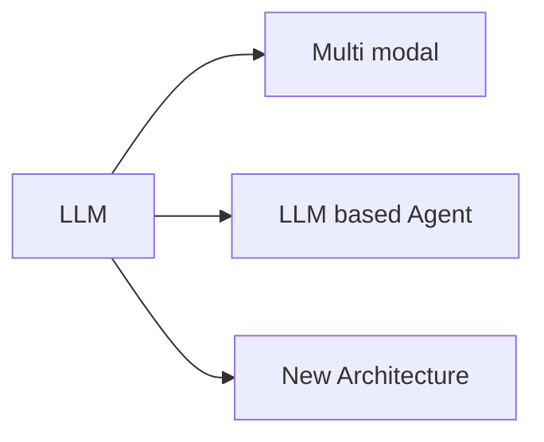

언어 모델 
* 다음에 올 단어를 에측하는 모델

언어 모델링
- 모델이 입력받은 텍스트의 다음 단어를 예측해 텍스트를 생성하는 방식
- 자연어 처리 분야의  [[사전 학습(pre-training)]] 과제로 많이 사용됨

언어 모델 발전의 주요 사건들
* 2013 : [[워드투벡 (Word2Vec)]]
* 2017 : [[트랜스포머 (Transformer)]]
* 2018 : [[GPT]] 공개

LLM (Large Language Model)
100억(10B) 개 이상의 파라미터를 가진 언어 모델

sLLM (small Large Language Model)
100억 (10B) 이하의 파라미터를 가진 LLM을 이용해서 훈련한 것
- 특정 도메인 데이터나 작업에 맞게 학습하여 도메인 성능을 높인 모델

모델의 크기가 크고 연산량이 많기 때문에 다양한 최적화 기법이 활용됨
[[양자화 (quantization)]]
[[LoRA (Low Rank Adaptation)]]

언어 모델은 실제하지 않는 잘못된 정보를 생성할 수 있음
- 이를 환각 현상이라고 함
- [정렬 (alignment)](정렬%20(alignment).md)에 사용되는 정보가 [사전 학습(pre-training)](사전%20학습(pre-training).md)학습에 없는 경우 발생할 수 있음
- 정확한 원인은 알지는 못함
- [[RAG (Retrieval Augmented Generation)]] 을 통해 문제를 완화함

언어 모델은 아래 방향으로 발전하는 중
